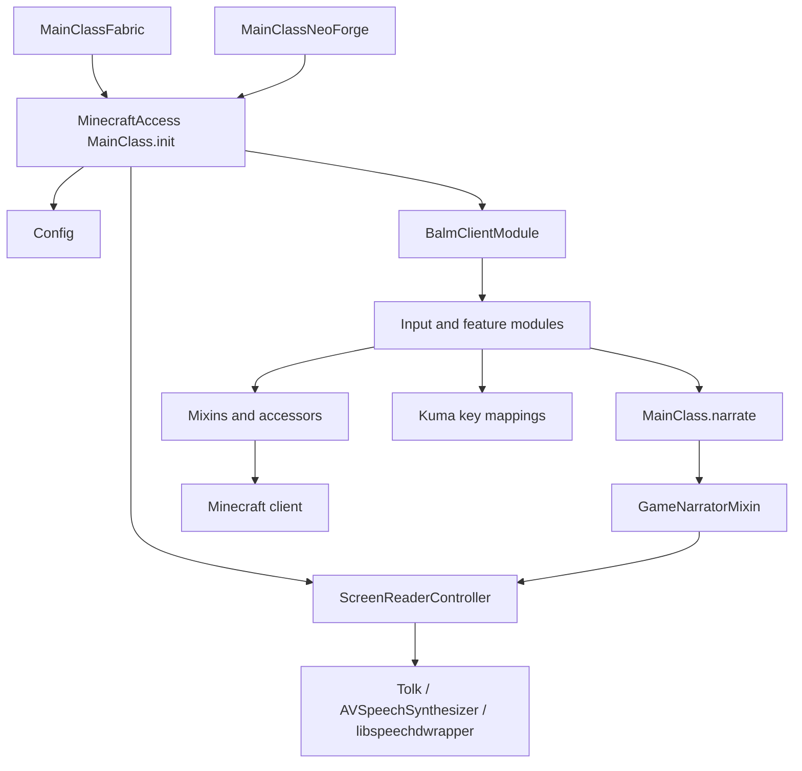
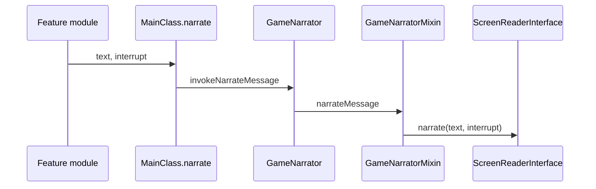

# 系统总览

## 定位与边界

Minecraft Access 是一个客户端 Minecraft 模组，为视觉障碍玩家提供屏幕朗读、声音提示和键盘化界面操作。它同时支持 Fabric 与 NeoForge，不向服务端添加逻辑。

主要边界：

- 游戏状态和容器操作仍由 Minecraft 客户端原版流程执行。
- 所有键盘、鼠标和屏幕操作都在客户端线程发生。
- 屏幕阅读器通过平台接口输出语音，不由 Minecraft 自带叙述器直接播放。
- 模组必须兼容原版界面、部分第三方模组界面和不同 GUI 缩放。

## 构建结构

Gradle 是一个三项目构建：

| 项目 | 作用 |
|---|---|
| 根项目 | 编译公共代码，生成 `minecraft-access` 主 JAR |
| `:fabric` | Fabric 客户端开发运行配置和 Fabric 打包入口 |
| `:neoforge` | NeoForge 客户端开发运行配置和 NeoForge 打包入口 |

根项目同时使用 Fabric Loom、NeoForge ModDev、Shadow 和 Checkstyle。项目目标 Java 为 25，Minecraft 为 26.3，配置见 [build.gradle](../../../build.gradle)。

## 运行时分层

### 平台入口

- Fabric 入口 [MainClassFabric.java](../../../src/main/java/org/mcaccess/minecraftaccess/fabric/MainClassFabric.java) 收集 Fabric addon，然后交给 `BalmClient.initializeMod`。
- NeoForge 入口 [MainClassNeoForge.java](../../../src/main/java/org/mcaccess/minecraftaccess/neoforge/MainClassNeoForge.java) 扫描 NeoForge addon，并注册配置屏幕扩展点。
- 两个入口最终调用同一个 [MainClass.init](../../../src/main/java/org/mcaccess/minecraftaccess/MainClass.java#L81)。

### 公共主流程

[MainClass.java](../../../src/main/java/org/mcaccess/minecraftaccess/MainClass.java) 负责：

1. 初始化原生库和 addon 注册表。
2. 初始化配置。
3. 刷新平台屏幕阅读器。
4. 注册功能模块。
5. 注册全局客户端 tick 回调。
6. 提供统一的 `narrate(String, boolean)` 出口。

屏幕阅读器接口位于 `screen_reader/`：

- Windows 使用 Tolk，可在没有专业读屏器时回退到 SAPI。
- macOS 使用 `AVSpeechSynthesizer`。
- Linux 使用 `libspeechdwrapper`，通过 Speech Dispatcher 输出。

`GameNarratorMixin` 把 Minecraft 原生叙述转发给该接口，而不是转发给默认叙述器。

## 功能模块

| 模块组 | 主要职责 |
|---|---|
| `features/inventory_controls` | 容器槽位分组、导航、朗读和鼠标操作 |
| `features/point_of_interest` | 附近方块、实体、锁定和目标追踪 |
| `features/CameraControls` | 键盘相机控制和方向朗读 |
| `features/PlayerStatus` | 生命、饥饿、状态效果和警告 |
| `features/NarrateHeldItem` | 主手、副手和光标携带物朗读 |
| `features/MenuFix` | 修复部分原版菜单的焦点和叙述异常 |
| `addon/accessmenu` | 可扩展辅助功能菜单 |
| `compat` | Cloth Config 等第三方 UI 适配 |
| `api` | addon、世界叙述器等扩展接口 |

功能模块通常实现 `BalmClientModule`，在 `initialize()` 中注册 tick 和按键回调。当前源码有 30 个 `features` Java 文件和 59 个 mixin 文件，说明原版行为适配仍是主要集成手段。

## 输入路径

当前有两类输入：

1. **Kuma 管理键位**：适合可配置的 Minecraft Access 键位。使用 `ClientTickCallback`、`handleScreenInput` 和 `handleWorldInput` 处理输入。
2. **Mixin 或直接事件注入**：适合原版未暴露的焦点、叙述和控件内部状态。

[NavigationUtils.java](../../../src/main/java/org/mcaccess/minecraftaccess/utils/ui/NavigationUtils.java) 已经封装 `nextFocusPath`、`clearFocus` 等原版焦点 API，但背包导航当前没有使用这些方法。背包模块维护自己的方向图，并在操作时模拟鼠标。

## 叙述路径

`MainClass.narrate` 在窗口不活跃、文本为空或原版叙述器关闭时抑制输出。功能模块可以直接走这条路径，也可以依赖原版控件焦点和 `NarratableEntry`。

背包当前混用了两种路径：

- 普通槽位由 `InventoryControls` 直接构造文本并朗读。
- 配方按钮由 `RecipeButtonMixin` 截获原版 `updateWidgetNarration`，并借助鼠标移动触发。

这种混用是配方书行为不稳定的核心结构原因之一。

## 配置

[Config.java](../../../src/main/java/org/mcaccess/minecraftaccess/Config.java) 使用 Cloth Config/AutoConfig。背包相关配置包括：

- 是否启用背包控制。
- 是否自动打开配方书。
- 是否朗读当前槽位内容变化。
- 150 ms 的背包轮询延迟。
- 合成格行列前缀格式。

配置在运行时读取。背包模块当前每次 tick 调 `loadConfig()`，而不是订阅配置变更事件。

## 测试与当前覆盖

生产代码目前只有 6 个 JUnit 测试，集中在格式化和方向工具；没有背包导航、配方书、叙述顺序或输入时序测试。

因此当前背包设计的主要保障依赖人工验证和上游 CI 构建。任何替换鼠标或焦点模型的工作都必须新增可自动化的状态与顺序测试，不能只验证“能编译”。

## 架构约束

1. **客户端线程约束**：GUI、`hoveredSlot`、焦点和输入状态只能在客户端主线程修改。
2. **原版行为优先**：能用原版焦点、叙述或容器操作路径时，不重复实现其状态机。
3. **Mixin 最小化**：Mixin 用于获得缺失状态或注入事件，不应成为仅有的业务规则所在地。
4. **跨平台一致**：公共行为必须同时适用于 Fabric 和 NeoForge。
5. **无障碍优先**：视觉悬停不能成为语音信息的必要条件。
6. **兼容性兜底**：未知或模组界面需要保留可用的通用导航路径。
