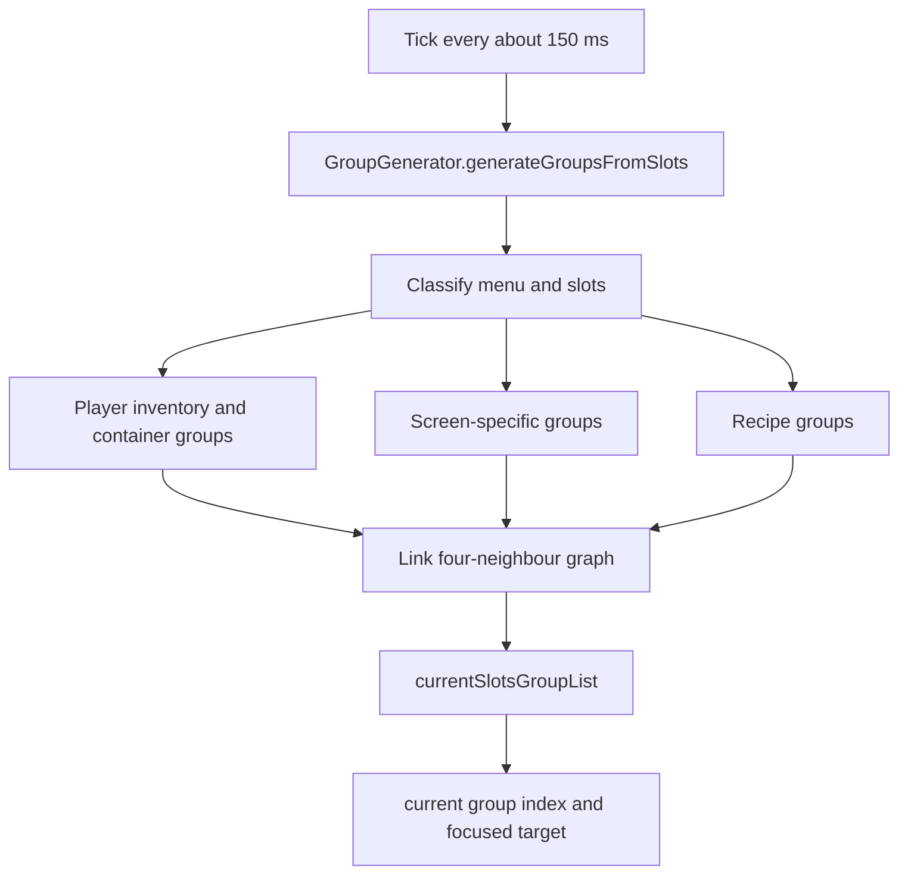
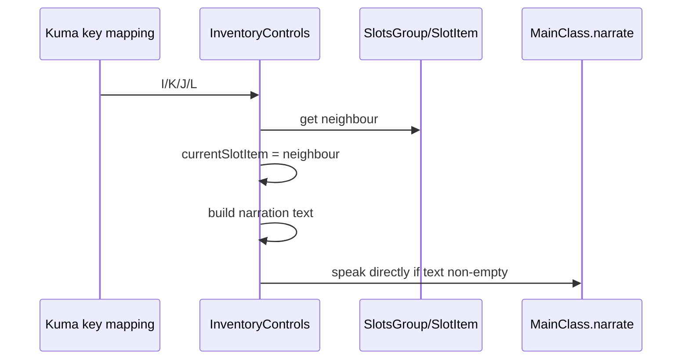

# 背包导航当前状态

> 实现快照：2026-10-25。以下“当前”描述工作区中的最小改造实现；旧问题保留在根因分析文档中。

## 用户可见能力

`Inventory Controls` 实际上覆盖所有 `AbstractContainerScreen`，不只是玩家背包。现有能力包括：

- 按 `I/K/J/L` 在二维槽位组中移动。
- 按 `C` 和 `Shift+C` 切换槽位组。
- 按 `V` 和 `Shift+V` 切换配方分类或创造模式标签页。
- 按 `R` 切换“仅显示可制作”。
- 按 `T` 聚焦搜索框或文本框。
- 按 `Shift+I/K` 翻配方书或滚动未知可滚动组。
- 使用 `[`、`]`、`\` 模拟鼠标左键、右键和中键。
- 朗读槽位内容、物品数量、工具提示、特殊配方、交易和附魔信息。

用户文档见 [features.md](../../content/features.md) 和 [keybindings.md](../../content/keybindings.md)。

## 核心类型

| 类型 | 职责 |
|---|---|
| `SlotsGroup` | 一个命名槽位组，保存二维列表和四方向邻居 |
| `SlotItem` | 一个可导航目标，可能对应真实 `Slot`，也可能只是坐标或文本 |
| `GroupGenerator` | 从当前容器和特殊控件生成槽位组 |
| `InventoryControls` | 保存当前屏幕、组、目标和按键行为 |
| `CursorActionSequence` | 保证鼠标动作前只同步一次光标 |
| `FocusedVariantTracker` | 检测焦点或配方显示变体是否变化 |
| `RecipeBookPageNavigator` | 选择翻页后目标行中最近的可见列 |
| `RecipeBookCategoryLabels` | 从显式标签、注册 ID 和语言键解析分类名 |
| `InventoryScreenInput` | 区分普通控件焦点与正在接收字符的文本框焦点 |
| `MouseUtils` | 在动作手势发生时移动硬件光标并模拟鼠标按键 |
| `RecipeButtonMixin` | 对逻辑焦点之外的手动 hover 保留兼容叙述 |

## 目标模型

`SlotItem` 有四种主要形态：

1. 包装真实 `Slot`。
2. 仅表示屏幕坐标，例如配方按钮。
3. 表示行列位置，例如织布机图案。
4. 表示固定文本，例如附魔按钮或信标按钮。

方向关系由 `SlotsGroup.mapTheGroupList(factor[, transpose])` 根据列表索引预连线。部分特殊组在移动时还会扫描 `x/y` 坐标。

这说明当前模型同时承担：

- 屏幕位置。
- 容器槽位身份。
- 焦点状态。
- 可点击性。
- 朗读文本来源。

这些职责没有清晰边界，导致特殊控件必须堆叠条件分支。

## 建模流程

tick 仍保留原有的约 150 ms 刷新节奏。列表刷新不会根据组 key 推断或补做分组切换；这类兜底曾作为一次错误修复加入，现已删除。页面、分类等明确改变屏幕结构的操作仍由各自路径刷新列表并重选配方组。

## 屏幕输入路由

Minecraft 26.3 的 `AbstractRecipeBookScreen.mouseClicked()` 在配方按钮被激活后会调用 `setFocused(recipeBookComponent)`。Kuma 默认会跳过存在聚焦控件时的屏幕映射，因此普通的 `C`、`Shift+C` 和方向键在选配方后会失效。

当前所有背包屏幕快捷键在 Kuma 注册时都调用 `ignoreScreenFocus()`，再经过 `InventoryScreenInput`：

1. 配方书、按钮或其他普通控件获得焦点时，快捷键继续工作。
2. 一旦配方书、创造模式背包或铁砧的文本框正在接收输入，快捷键返回未处理，让原版文本框消费字符。
3. 按 Enter 退出文本框后，原导航行为恢复。

`EditBox.canConsumeInput()` 是文本输入保护的唯一判断，不根据源码文本或分类状态硬编码快捷键例外。

## 导航时序

真实槽位可以立即构造文本，因为 `SlotItem.slot` 指向当前 `Slot`。

配方 `SlotItem` 保存真实 `RecipeButton`，其 `getNarratableText()` 直接读取当前轮换的 `ItemStack`，因此导航本身即可朗读配方名称和可制作状态。

### 当前横向边界行为

当前方向图为矩形组保留列边界：

- `J` 在左边界找不到左侧目标。
- `L` 在右边界找不到右侧目标。
- 找不到目标时朗读 `no_slot_in_direction`，不会换行或翻页。

这是现有原功能的一部分。目标设计必须保留该行为，不能把横向导航改成连续阅读顺序。

## 鼠标操作

[MouseSimulation.java](../../../src/main/java/org/mcaccess/minecraftaccess/features/MouseSimulation.java) 在客户端 tick 中观察 `[`、`]`、`\` 的按下和释放状态。按下时先调用 `InventoryControls.syncFocusedCursorForMouseAction()`，只有目标仍然有效时才由 `CursorActionSequence` 调用原鼠标 `press()`；释放不移动光标。屏幕已关闭或不在容器界面时仍保留原版世界鼠标操作。

`MouseUtils`：

- 用 `SDL_WarpMouseInWindow` 更新平台光标。
- 调用 `MouseHandler.onMove` 更新 Minecraft GUI 的鼠标位置。
- 在 Windows 的 `moveAndLeftClick` 中同步休眠 20 ms。
- 不再包含后台延迟移动方法或 `java.util.Timer`。

导航与硬件光标已经解耦；只有动作手势才把两者同步。点击仍沿用原版鼠标和容器路径。

## 槽位组顺序

通用容器大致采用以下顺序：

1. 打开的容器库存。
2. 玩家主背包。
3. 快捷栏。
4. 输入槽。
5. 输出槽。
6. 未知槽位。
7. 特殊控件。
8. 盔甲和副手。

特殊界面包括熔炉、村民、切石机、制图台、织布机、铁砧、锻造台、酿造台、砂轮、信标、附魔台、创造模式背包等。实现集中在 [GroupGenerator.java](../../../src/main/java/org/mcaccess/minecraftaccess/features/inventory_controls/GroupGenerator.java)。

未知模组槽位按空间相邻性聚类，并尝试用 `Slot` 类名命名组。这个兜底方案对未知槽位有用，但不理解按钮、列表项和非槽位控件。

## 配方书适配

配方按钮来自 `RecipeBookPage.buttons`。当前实现：

1. `GroupGenerator.recipeBookGroups()` 只遍历 `visible == true` 的按钮。
2. `SlotItem` 保存 `RecipeButton` 引用。
3. `RecipeBookNarration` 生成“可制作状态 + 数量 + 名称”。
4. `FocusedVariantTracker` 每 tick 比较配方 ID、物品、数量和数据组件。
5. 变体变化后直接朗读，不抖动鼠标。
6. 手动 hover 且未由逻辑焦点接管的按钮仍保留 `RecipeButtonMixin` 兼容朗读，但不再移动鼠标。

旧静态 `GroupGenerator.recipesOnTheScreen`、`RecipeBookPageMixin` 和抖动鼠标焦点路径已删除。

切换分类的 `changeRecipeTab` 只遍历可见标签，使用原版 `RecipeBookComponent.mouseClicked` 激活目标，并直接朗读“分类名称 (当前位置/总数)”。原生分类、搜索分类和注册模组分类通过 `RecipeBookCategoryLabels` 解析；未知分类回退到可读注册 ID。

## 当前优点

- 对普通容器槽位的原版操作语义保留较好。
- 鼠标点击仍经过原版鼠标和容器路径，第三方界面兼容成本低。
- 槽位分组顺序参考了常用工作流。
- 未知槽位有坐标聚类兜底。
- 已有多语言组名和物品朗读。
- 导航不再移动硬件鼠标。
- 配方变体按当前显示内容直接朗读。
- 配方页只包含可见按钮。
- 翻页与分类切换不再创建后台定时器。

## 当前结构性风险

| 风险 | 直接证据 | 影响 |
|---|---|---|
| 每约 150 ms 重建槽位模型 | `generateGroupsFromSlots` 仍在 tick 主路径 | 大型模组背包可能有分配和 GC 压力 |
| 未接管的配方 hover 仍使用兼容路径 | `RecipeButtonMixin` 仍提供非逻辑焦点的 hover 朗读 | 手动 hover 与逻辑焦点是两套叙述来源，测试时需分别验证 |
| 背包控制关闭后不再主动刷新静态 hover 变体 | 已删除 `shakeTheMouse`，关闭时没有对应客户端 tick 跟踪 | 鼠标停在同一配方按钮时，后续轮换结果可能不朗读；移动鼠标或重新 hover 会触发 |
| 已排队的一次 hover 叙述可能晚到 | `ownsRecipeNarration` 只忽略当前逻辑目标 | 快速切换焦点时可能残留一次旧按钮叙述，需真实客户端验收 |
| 缺少真实合成台 GameTest | 当前只有纯逻辑和现有 JUnit 测试 | 页面切换和分类点击仍需人工 GUI 验证 |
| 未做逐项屏幕阅读器主观验收 | 开发客户端只验证到初始化和设置界面 | 语速、打断和连续操作舒适度仍需用户测试 |
