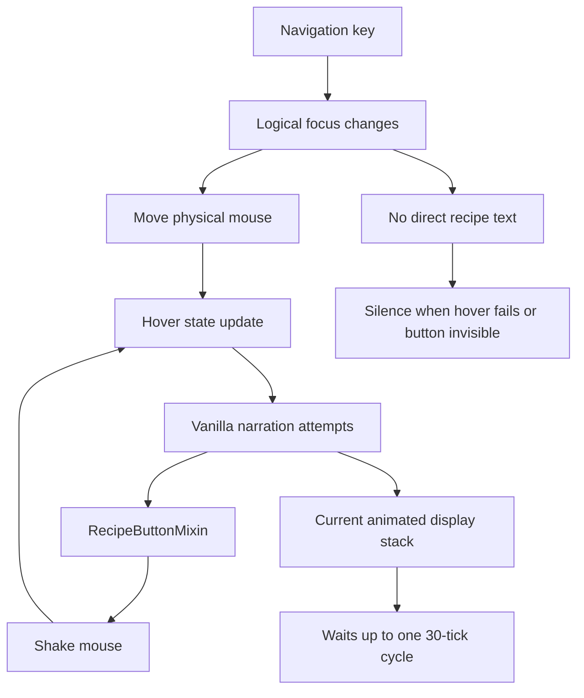

# 配方书延迟与静默分析

## 问题陈述

用户报告：

- 在配方书内移动时，导航和朗读有明显延迟。
- 一个按钮内存在多个配方结果时，例如不同木材的木板，结果会变化，但当前朗读不能稳定地及时跟上。
- 配方书第二页及之后有时完全不朗读。

仓库用户文档已经承认前两项现象，见 [features.md](../../content/features.md#L113)。这说明问题不是单一设备上的偶发现象。

## 本次证据范围

本次分析检查了：

- 项目 `dev` 提交 `0442bfc1`。
- 项目构建生成的 Minecraft 26.3.0.95 源码 JAR。
- Controlify 和 MidnightControls 的当前源码。
- Fabric 官方 GUI、键位和事件文档。

本次没有启动带屏幕阅读器的完整客户端做声学计时，因此：

- “代码中存在哪些延迟来源”属于已确认结论。
- “各来源在特定设备上占多少毫秒”属于待仪器化验证的假设。

## 正常槽位与配方槽位的差异

### 普通槽位

1. `SlotItem` 保存真实 `Slot`。
2. 导航把鼠标移到槽位中心。
3. `getCurrentSlotNarrationText()` 直接读取 `Slot.getItem()`。
4. 功能模块调用 `MainClass.narrate()`。

普通槽位的朗读不依赖原版是否触发悬停叙述。

### 配方槽位

1. `SlotItem` 只保存按钮坐标。
2. `slot` 为 `null`。
3. `getNarratableText()` 对普通配方返回空字符串。
4. 导航不产生配方朗读。
5. 鼠标移动到按钮后，原版 `RecipeButton.updateWidgetNarration` 才被调用。
6. `RecipeButtonMixin` 截获该调用，自己调用 `MainClass.narrate()`。
7. 为了让同一个按钮在内容变化后再次产生叙述，Mixin 在按钮内部来回抖动鼠标。

这条路径把“朗读事件”寄托在“鼠标移动是否触发原版叙述”上。

## 已确认的延迟来源

### 1. 配方按钮本身按原版时间轮换显示物

Minecraft 26.3 的 `RecipeBookComponent` 使用：

```java
SlotSelectTime slotSelectTime = () -> Mth.floor(this.time / 30.0F);
```

`RecipeButton.getDisplayStack()` 用这个索引选择当前配方结果。按钮处于动画状态时，`time` 每帧增加；其变化节奏对应约 30 tick。

结论 E2：

- 同一个按钮的“当前显示变体”不会因为用户刚把鼠标移入而立刻切换。
- 每个变体通常保持约 1.5 秒。
- 用户移动焦点后，可能先读到当前变体，随后必须等待下一次轮换才能读到其他变体。

这不是要修复的延迟，而是原版展示节奏。修复目标应是：

- 当前变体出现时立即朗读。
- 变体变化后在一个客户端 tick 内检测并朗读。
- 不冻结、不跳过原版变体轮换。

### 2. 导航时移动真实鼠标

`focusSlotItem()` 在每次导航时调用 `moveToSlotItem()`，后者通过 SDL 改变硬件光标，并直接调用 `MouseHandler.onMove`。

这种设计带来的额外成本：

- 鼠标移动、屏幕 hover 更新和叙述触发至少跨越多层逻辑。
- 视觉焦点、逻辑焦点和真实光标可能短暂不一致。
- 后续按键仍依赖这次 hover 是否被原版识别。
- Windows 路径存在同步等待和延迟移动补丁。

### 3. 抖动鼠标是显式症状补丁

[RecipeButtonMixin.java](../../../src/main/java/org/mcaccess/minecraftaccess/mixin/RecipeButtonMixin.java) 的注释写明：

- `appendNarrations` 会在鼠标移动后调用。
- 抖动是为了触发不同变体的朗读。
- 作者知道它不是根因解决方案。

因此当前延迟不能被解释为“屏幕阅读器本身慢”。

### 4. 每 150 ms 重建槽位图

`InventoryControls` 在每次通过 interval 的 tick 中调用：

```java
currentSlotsGroupList = GroupGenerator.generateGroupsFromSlots(currentScreen);
```

通用组生成会：

- 复制 menu slot 列表。
- 扫描容器类型。
- 创建全部 `SlotItem`。
- 对未知槽位执行空间聚类。
- 为特殊界面重算坐标。
- 重新连线方向关系。

该开销不一定直接产生一秒延迟，但会在复杂或大型背包中造成输入抖动和垃圾回收压力。它属于架构级浪费，而不是单一配方书问题。

### 5. 翻页和切换分类使用延迟鼠标定时器

翻页和切换分类会直接模拟一次鼠标点击，然后：

```java
moveToSlotItem(currentSlotItem, 100);
```

该方法为每次操作创建新的 `java.util.Timer`。GUI 和鼠标状态不属于该定时器线程。即使现有版本通常没有崩溃，也缺少线程安全和事件顺序保证。

### 6. 模型刷新和当前焦点可能不同步

每次 tick 都会替换 `currentSlotsGroupList`，但没有在同一次流程中替换 `currentGroup` 和 `currentSlotItem`。当前导航对象可能来自上一轮模型。

这是状态一致性风险；它是否直接造成某一秒延迟需要运行时日志验证。

## 第二页静默的已确认高风险点

当前组生成逻辑为配方组使用：

```java
for (int i = 0; i < slots.size() && i < recipesOnTheScreen.size(); i++) {
    ...
    recipesGroup.slotItems.add(new SlotItem(realX, realY));
}
```

它没有检查：

- `RecipeButton.visible`
- 当前页实际剩余数量
- 按钮是否仍绑定有效配方

最后一页少于 20 项时，仍会创建 20 个可导航坐标。用户移动到不可见按钮时：

- 鼠标到了空白区域。
- 原版不会产生配方悬停叙述。
- 自定义路径没有配方文本可读。

这与用户文档中的“第二页以后有时不朗读”高度一致。

结论：

- E1：不可见按钮没有被过滤。
- E1：不可见按钮没有直接配方文本。
- E2：原版只有可见/激活按钮参与可叙述控件搜索。
- H：这是第二页静默的主要或至少重要原因，仍需用 GameTest 和实机日志确认是否还有其他贡献者。

## 其他不一致

### 静态配方集合

`RecipeBookPageMixin` 在 `updateCollections` 开头把输入集合写入静态字段。该字段：

- 位于 `GroupGenerator`，不与该页面实例绑定。
- 在方法真正更新分页和按钮前写入。
- 不保证所有页面切换后都被立即替换。
- 没有空值保护。

更稳定的数据来源应是当前 `RecipeBookPage.buttons` 的可见按钮及其当前 `RecipeButton` 状态。

### 组命名缺陷

未知槽位重复组计数使用 `duplicateCounters.put(groupName, ...)`，而前一个分支检查的是 `groupKey`。这可能导致组编号不一致。该问题不直接造成配方书延迟，但会污染未知模组界面的导航语义。

## 因果链



## 根因结论

主要问题不是缺少某个延时参数，而是三个职责被绑在一起：

1. **焦点**依赖真实鼠标位置。
2. **配方语义**只存在于按钮悬停副作用。
3. **变体朗读**通过抖动鼠标间接实现。

只调整 150 ms interval、增加延时或缩短按钮动画都会造成副作用：

- 调整 interval 会让普通输入变慢。
- 缩短轮换会破坏原版视觉节奏。
- 继续抖动鼠标仍无法保证不可见按钮、模组界面和叙述去重。

正确修复必须把“导航与朗读”和“鼠标操作”拆开，同时保留原版点击路径作为动作兼容层。

## 可行性判断

“导航时不移动鼠标、直接朗读；按鼠标动作键时先移动再执行”的方案可行：

1. 普通槽位已有稳定坐标，可在动作前同步。
2. 原版点击仍由 `MouseHandler` 和 `AbstractContainerScreen` 执行，兼容性最高。
3. 配方按钮有 `getDisplayStack()` 和 `RecipeDisplayId`，可在客户端 tick 中检测变体。
4. 鼠标同步可放到下一客户端 tick，避免 `Timer` 线程。
5. 现有 `MainClass.narrate()` 已能直接调用平台屏幕阅读器。

需要新增的不是新的 UI 渲染引擎，而是明确的焦点状态、叙述协调器和光标动作桥。

## 2026-10-25 实现结果

工作区已实施最小修复：

- 导航不再移动硬件鼠标。
- 普通槽位和配方按钮均直接朗读。
- 配方变体键包含配方 ID、物品、数量和数据组件。
- 配方组只包含当前页可见按钮。
- `K/I` 纵向越界自动翻页，`J/L` 横向越界保持原提示。
- 翻页和分类切换调用原版 GUI 点击，不移动硬件鼠标。
- `java.util.Timer` 延迟鼠标路径已删除。
- 分类切换直接朗读名称和可见位置。

Fabric 和 NeoForge 开发客户端都完成了模组、Mixin、资源和 Tolk/NVDA 初始化。尚未自动进入世界执行真实合成台操作，因此延迟体感和连续语音体验仍需要人工验收。
