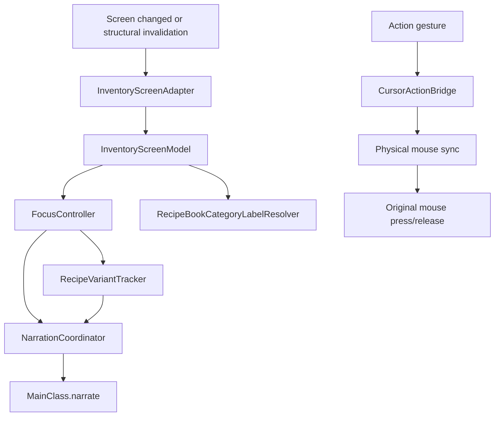
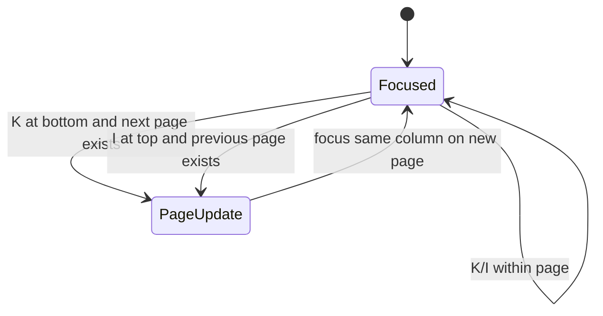
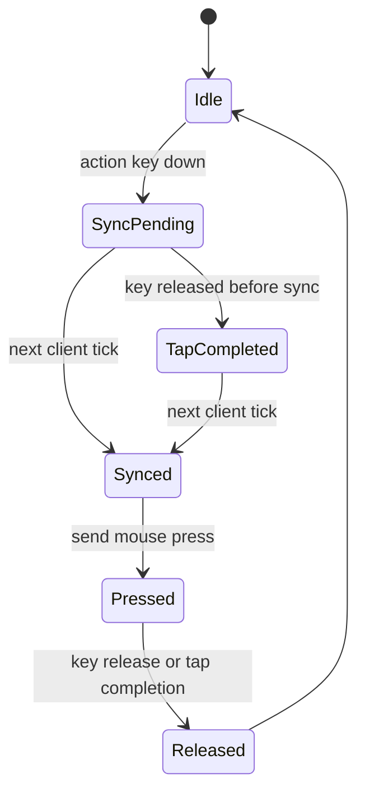
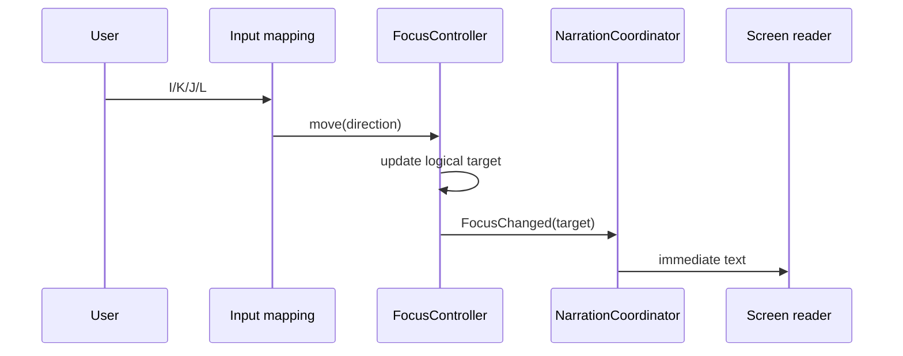
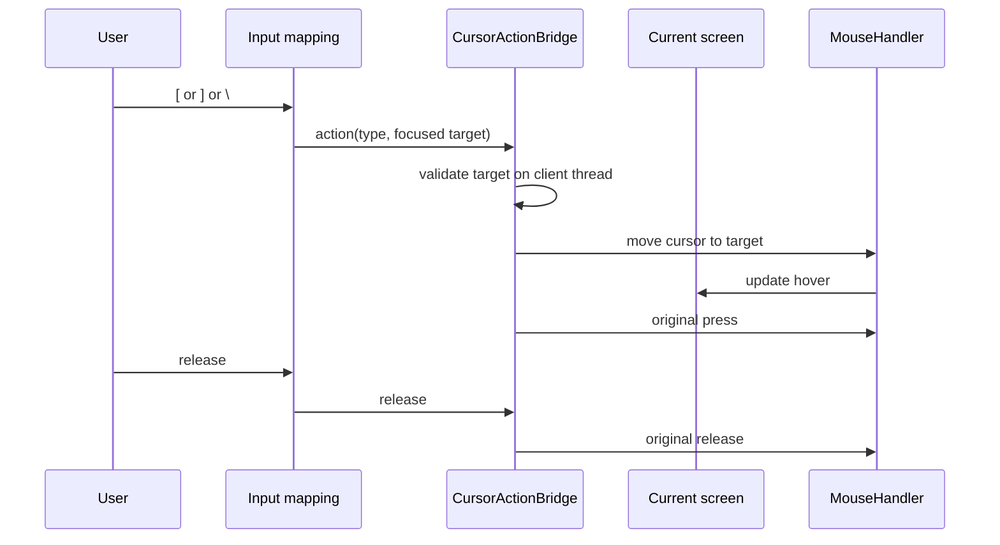

# 背包导航目标设计

> 2026-10-25：最小实现已落在工作区；自动翻页、分类朗读、直接配方变体和惰性光标同步均已接入。真实世界中的逐项屏幕阅读器体验仍需人工验收。

## 目标

把背包控制拆成六个清晰职责：

1. 发现当前屏幕中的可导航目标。
2. 维护稳定逻辑焦点。
3. 为焦点生成朗读文本。
4. 跟踪配方按钮当前变体。
5. 在动作手势发生时同步光标并执行原版操作。
6. 为未知界面保留通用兜底。

## 不改变的行为

- 现有默认键位和可重映射键位保持不变。
- 普通槽位拿取、放置、交换、半组、快捷移动和丢弃语义保持不变。
- 配方书仍自动打开，仍按原有分类、过滤、搜索和分页工作。
- 配方按钮仍按原版节奏在多个结果之间轮换。
- 当前屏幕阅读器、配置系统和跨平台入口保持不变。
- `Inventory Controls` 关闭后，原有非该功能的悬停朗读行为不能被破坏。

## 最小干预原则

本改造采用渐进替换，不重写整个背包子系统：

- 保留现有槽位分组、特殊界面处理、配置项和默认键位。
- 保留 `MouseSimulation` 和原版鼠标点击语义。
- 复用现有 `SlotItem`/`SlotsGroup`，只增加必要的目标类型和稳定焦点引用。
- 新逻辑优先放进普通可测试类；Mixin 只读取缺失状态或转发事件。
- 先让公共代码在 Fabric 与 NeoForge 上走同一路径，再为确实存在的加载器差异增加窄适配器。
- 如果功能能由原版公共类实现，不创建只服务一个加载器的实现。

跨加载器约束见 [跨加载器兼容设计](../architecture/cross-loader-compatibility.md)。

## 初始最小改动边界

第一阶段只触碰背包功能已有的责任边界：

| 现有位置 | 最小改动 |
|---|---|
| `InventoryControls` | 导航不再移动鼠标；纵向配方边界翻页；分类切换直接朗读 |
| Kuma input registration | 背包快捷键绕过普通控件焦点，但让可接收输入的 `EditBox` 优先 |
| `GroupGenerator` | 配方目标只使用当前页可见按钮；修正焦点引用刷新 |
| `RecipeButtonMixin` | 移除抖动鼠标，记录或转发当前已显示变体 |
| `MouseSimulation`/`MouseUtils` | 动作手势先排队同步光标，再执行原有鼠标操作 |
| 语言资源 | 增加分类名称和翻页边界文本 |

第一阶段不新增 Screen、不替换键位系统、不改普通容器的特殊分组、不直接调用 `slotClicked` 绕过原版点击。

## 架构



### `InventoryScreenAdapter`

将原版或模组 Screen 转换为领域模型。适配器只负责读取屏幕结构：

- 真实 `Slot`。
- 配方按钮和当前页。
- 分类、过滤和翻页按钮。
- 输入框。
- 屏幕特定按钮。
- 未知可点击控件。

适配器不能直接朗读，也不能直接执行动作。

### `InventoryScreenModel`

保存稳定目标 ID、目标类型、位置、所属组、可用动作和屏幕结构版本。

建议目标类型：

```java
sealed interface InventoryTarget {
    TargetId id();

    record SlotTarget(TargetId id, Slot slot) implements InventoryTarget {}
    record RecipeTarget(TargetId id, RecipeButton button) implements InventoryTarget {}
    record CategoryTarget(TargetId id, RecipeBookTabButton button) implements InventoryTarget {}
    record WidgetTarget(TargetId id, AbstractWidget widget) implements InventoryTarget {}
    record TextTarget(TargetId id, Widget widget) implements InventoryTarget {}
}
```

`TargetId` 必须在单次屏幕生命周期内稳定，不能使用“列表里的第几个对象”作为唯一身份。

### `FocusController`

负责：

- 当前组和当前目标。
- 四方向移动。
- 空组或越界提示。
- 屏幕结构变化后的焦点恢复。
- 发出 `FocusChanged` 事件。

导航阶段不调用任何鼠标移动方法。

焦点恢复规则：

1. 原目标仍存在时保留焦点。
2. 原目标消失时，优先选择同组最近的有效目标。
3. 列表刷新本身不触发跨组跳转，也不根据组 key 推测用户意图。
4. 配方翻页后，如果原位置有可见按钮则保持原位，否则选择该页第一个可见按钮。

整组消失后的跨组回退曾作为“选中配方后无法切组”的修复候选加入，后续确认根因是 Kuma 焦点路由，该实现已经删除。

### 屏幕输入焦点

Kuma 的屏幕输入默认不处理存在聚焦控件的界面。配方书被点击后，原版会把 `RecipeBookComponent` 设为焦点，因此背包快捷键映射必须使用 `ignoreScreenFocus()`。

绕过 Kuma 的通用焦点保护后，背包功能自行执行一项更窄的保护：

1. 获取当前屏幕中正在接收输入的 `EditBox`。
2. 如果该文本框的 `canConsumeInput()` 为真，返回未处理。
3. 其他控件焦点不阻止背包快捷键。

这保留了旧轮询实现“普通 GUI 控件不挡快捷键、文本输入优先”的语义，并且不依赖配方书内部子控件的遍历结构。

### `NarrationCoordinator`

统一定义：

- 朗读键：目标 ID、内容类型和变体 ID。
- 即时策略：用户导航和变体变化使用 interrupt，保持现有“立即更新”的行为。
- 去重策略： `targetId + contentKind + contentHash + displayRevision` 相同则不重复；真正的变体版本变化不受时间节流抑制。
- 光标同步策略：动作前同步导致的 hover 朗读在动作完成前以及完成后一个客户端 tick 内视为重复。

建议文本结构：

- 普通槽位：`行列前缀 + 数量 + 名称 + 非重复工具提示`。
- 配方：`可制作状态 + 变体序号（可用时）+ 数量 + 结果名称`。
- 分类：`第 n 个分类，共 m 个，名称`。
- 页面：`第 n 页，共 m 页`。
- 空目标：`区域 + 空槽位`。

不得通过移动鼠标来获得这些文本。

### `RecipeVariantTracker`

当焦点是 `RecipeTarget` 时启动。每个客户端 tick，或经过节流的渲染后检查：

1. `RecipeButton.getDisplayStack()` 返回的 `ItemStack`。
2. `RecipeButton.getCurrentRecipe()` 返回的 `RecipeDisplayId`。
3. 原版当前变体是否变化。

比较规则：

- `RecipeDisplayId` 变化时视为变体变化。
- `ItemStack` 的名称、数量或关键组件变化时也视为变化。
- 相同结果和数量的连续帧不重复朗读。

时序要求：

- 首次聚焦时立即朗读当前变体。
- 原版变体切换后，最多一个客户端 tick 发出朗读。
- 不修改 `slotSelectTime`，不冻结动画，不强制提前切换。

这与当前 `RecipeButtonMixin` 的 5 秒同物品节流不同。是否保留 5 秒节流需由叙述协调器按“同一变体重复 hover”处理，不能阻断真正的变体变化。

## 配方书纵向自动翻页

配方书使用固定的 5 列 × 4 行布局，但最后一页可能不满。翻页规则基于当前页可见目标，不基于固定 20 个坐标。

### 横向边界

- `J` 在左边界只朗读“左侧没有项目”。
- `L` 在右边界只朗读“右侧没有项目”。
- 横向导航永远不换行、不翻页。
- 无效方向不改变当前焦点。

### 纵向边界

- `K` 在当前页最底部且没有正下方目标时，自动进入下一页。
- `I` 在当前页最顶部且没有正上方目标时，自动返回上一页。
- 新焦点优先保留当前列：
  - 向下翻页进入下一页同列的第一行。
  - 向上翻页进入上一页同列的最后一行。
- 如果目标列不存在或不可见，选择目标行中水平距离最近的可见配方。
- 已是最后一页时，`K` 朗读“最后一页”，不循环。
- 已是第一页时，`I` 朗读“第一页”，不循环。
- `Shift+K` 和 `Shift+I` 继续保留为显式翻页快捷键。

纵向边界翻页属于逻辑导航，不移动真实鼠标。翻页动作应调用原版配方页按钮处理，然后等待 `currentPage` 和可见按钮更新，再把焦点放到目标列。



## 分类名称解析

Minecraft 26.3 不提供可直接朗读的分类名称：

- `RecipeBookTabButton` 只保存图标和分类对象。
- `ExtendedRecipeBookCategory` 是空标记接口。
- `RecipeBookCategory` 没有名称字段。
- 原版语言文件没有分类标题。

因此需要 `RecipeBookCategoryLabelResolver`，但不能把分类顺序和每个分类写成一个大型 `switch`。

解析顺序：

1. 模组或兼容适配器注册的显式 `Component`。
2. 已注册分类的 `BuiltInRegistries.RECIPE_BOOK_CATEGORY.getKey(category)` 得到 ID。
3. 查找 `minecraft_access.recipe_book.category.<namespace>.<path>`。
4. `SearchRecipeBookCategory` 使用以下固定翻译键：
   - `minecraft_access.recipe_book.search.crafting`
   - `minecraft_access.recipe_book.search.furnace`
   - `minecraft_access.recipe_book.search.blast_furnace`
   - `minecraft_access.recipe_book.search.smoker`
5. 没有翻译时朗读格式化的注册 ID，并明确这是分类标识。

原生分类的翻译条目集中放在语言文件中，分类顺序由屏幕实时提供的可见标签列表决定。这样升级游戏或加载模组时不需要修改导航逻辑。

切换 `V` 时：

1. 只遍历 `visible == true` 的分类按钮。
2. 使用当前可见分类列表计算前一个或后一个。
3. 激活原版分类按钮。
4. 等待选中状态更新。
5. 直接朗读 `分类名称 + 当前序号/总数`。
6. 刷新当前分类的配方模型，焦点按恢复规则处理。

### `CursorActionBridge`

把动作手势与导航解耦。它只负责在动作发生时同步光标。



规则：

1. 动作手势到来时记录当前逻辑目标及其结构版本。
2. 在客户端 tick 中确认目标仍有效。
3. 把真实光标移动到目标中心。
4. 完成一次 GUI input 更新后发送原版鼠标 press。
5. 根据真实按住时长发送 release。
6. 快速点按即使 press 和 release 在同一 tick 到达，也必须先同步、再 press、再 release。

当前实现中的 `java.util.Timer` 全部移除。

## 时序

### 导航与朗读



该路径不包含 `MouseHandler.onMove`。

### 动作手势



## 配方刷新

结构变化必须显式使模型失效：

- 页面改变。
- 分类改变。
- 过滤改变。
- 搜索文本改变。
- 物品栏变化导致可制作集合变化。
- 配方书打开或关闭。
- 屏幕重建。

失效后：

1. 等待原版完成 `updateCollections` 和 `updateButtonsForPage`。
2. 仅从 `visible == true` 的按钮构建配方目标。
3. 明确改变配方结构的页面和分类操作刷新列表并保持配方组。
4. 普通 tick 刷新不推断跨组切换。
5. 如果当前焦点仍可见，不强制跳回第一个目标。

删除 `GroupGenerator.recipesOnTheScreen` 静态全局状态。

## 未知界面兜底

如果 Screen 中存在无法语义分类的控件：

1. 真实 `Slot` 仍进入通用槽位模型。
2. 可见 `AbstractWidget` 可作为 `WidgetTarget` 加入附加组。
3. 未知容器继续使用空间聚类。
4. 所有目标至少支持“聚焦并朗读可见名称”和“延迟光标同步后点击”。
5. 若控件没有名称，朗读可操作状态和位置，不输出空字符串。

## 视觉焦点

逻辑焦点可以在屏幕上绘制焦点框，但它不是语音的必要条件。

目的：

- 保留低视力用户可见反馈。
- 避免硬件鼠标停在旧位置造成误导。
- 动作手势同步光标时，焦点框和鼠标目标一致。

焦点框不能在未启用背包控制时出现。

## 性能约束

- 空闲屏幕不应每个 tick 重建整张槽位图。
- 模型只在屏幕结构或容器结构变化时重建。
- 普通导航目标是 O(1) 邻居查找或小型列表扫描。
- 配方变体检查只针对当前聚焦按钮。
- 所有 UI 修改都在客户端主线程。

建议验收预算：

- 导航按键到朗读调用小于 50 ms，不含屏幕阅读器本身语速。
- 动作手势到鼠标 press 小于 100 ms。
- 变体变化到朗读调用不超过一个客户端 tick。
- 导航路径中硬件鼠标移动次数为 0。

## 分阶段迁移

### 阶段 1：可观测性和测试基线

- 记录焦点 ID、朗读键、实际鼠标操作和原版变体变化。
- 增加不依赖真实屏幕阅读器的输入顺序测试。
- 先运行 Fabric 和 NeoForge 的公共编译，建立双端基线。

### 阶段 2：逻辑焦点和直接朗读

- 导航停止移动鼠标。
- 普通槽位直接朗读。
- 配方按钮直接朗读当前 `getDisplayStack()`。

### 阶段 3：延迟光标动作桥

- `[`、`]`、`\` 在动作前同步光标。
- 移除 100 ms Timer 和同步 sleep。

### 阶段 4：配方书结构刷新

- 只暴露可见按钮。
- 删除静态配方集合。
- 翻页、分类、筛选和搜索统一触发刷新。

### 阶段 5：兜底和优化

- 未知控件虚拟光标兜底。
- 常用槽位直接动作适配器。
- 配方搜索/列表作为独立功能。

## 回滚边界

迁移期间保留当前鼠标优先实现作为可切换特征路径，用于：

- 对比自动测试结果。
- 排查未知模组界面兼容问题。

默认路径只有在以下条件全部满足后才切换：

- 普通容器操作测试通过。
- 配方书分页和变体测试通过。
- Fabric 与 NeoForge 构建均通过，且新增核心逻辑只存在于公共源码。
- 横向边界不会翻页，纵向边界自动翻页。
- 可见分类切换会朗读名称和序号。
- Windows、macOS、Linux 的屏幕阅读器人工验收通过。
- 没有跨线程 UI 调用。

## 明确不做

- 不改变原版配方按钮的轮换速度。
- 不要求屏幕阅读器在 1.5 秒展示周期内提前说出尚未显示的变体。
- 不在本设计阶段集成 JEI、REI 或 EMI。
- 不在导航时移动硬件鼠标。
- 不把外部模组源码复制进项目。
